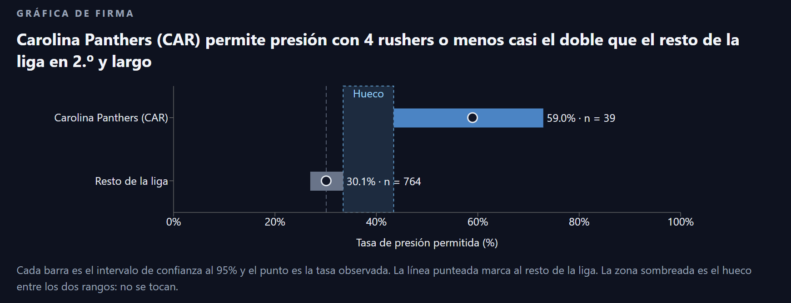
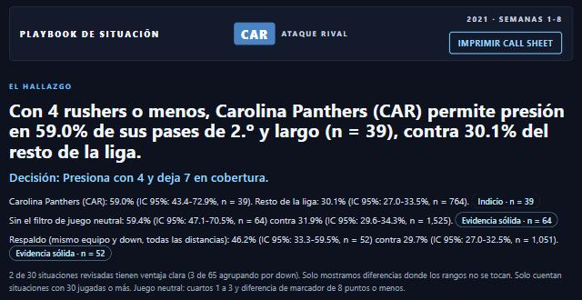
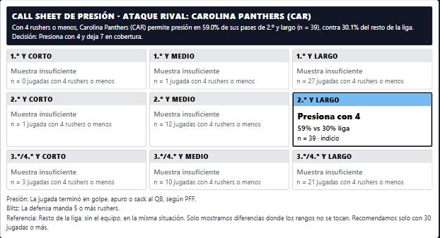

# Playbook de Situación: contra Carolina en 2.º y largo, 4 rushers son suficientes

> **Enfoque:** coordinador defensivo
> **Evento:** Hackathon NFL Big Data Bowl · UNAM 2026 · Yasser Vladimir Cruz Miranda



## El hallazgo

Cuando la defensa presiona con 4 pass rushers o menos, los Carolina Panthers permiten presión
sobre su quarterback en el **59.0%** de sus jugadas de pase en 2.º y largo (23 de 39 jugadas;
IC 95%: 43.4%–72.9%). En ese mismo escenario, el resto de la liga cede presión solo en el
**30.1%** de las veces (230 de 764; IC 95%: 27.0%–33.5%). Es prácticamente el doble, y los
intervalos de confianza ni siquiera se cruzan.

Para evitar sesgos por equipos obligados a lanzar por ir abajo en el marcador, filtré el
análisis a juego neutral (cuartos 1 a 3, con una diferencia máxima de 8 puntos). Además, al
abrir la muestra a todo el partido y a cualquier marcador, el patrón se sostiene casi idéntico:
**59.4% contra 31.9%** en 64 jugadas.

## Qué cambia en el plan de juego

Contra Carolina en 2.º y largo no tiene sentido arriesgar un blitz. Mandando solo a 4 jugadores
ya consigues incomodar al quarterback en más de la mitad de los intentos, y te quedan 7
defensivos atrás en cobertura. Para dimensionarlo: ese nivel de presión es comparable al 41.3%
que permite el resto de la liga cuando sí le mandan blitz.

## La evidencia

| Situación | Carolina | Resto de la liga | Jugadas | Nivel de evidencia |
|---|---|---|---|---|
| 2.º y largo, 4 rushers o menos, juego neutral | 59.0% (43.4%–72.9%) | 30.1% (27.0%–33.5%) | 39 | Indicio |
| 2.º y largo, 4 rushers o menos, todo el partido | 59.4% (47.1%–70.5%) | 31.9% (29.6%–34.3%) | 64 | Sólida |
| 2.º down (cualquier distancia), 4 rushers o menos, juego neutral | 46.2% (33.3%–59.5%) | 29.7% (27.0%–32.5%) | 52 | Sólida |

De 30 situaciones evaluadas con muestra suficiente, únicamente 2 arrojaron una ventaja clara. Al
agrupar por down sin separar distancia, solo 3 de 65 cumplieron el criterio. Carolina aparece en
ambos niveles.

## Cómo explorarlo en la app

Todo vive en una sola vista pensada para leerse rápido:

* Arriba aparece el hallazgo principal y la gráfica comparativa de Carolina frente al resto de
  la liga, con la brecha entre intervalos sombreada.
* Abajo están las tarjetas por equipo y la consulta por down y distancia. Para replicar este
  caso basta seleccionar Carolina Panthers (CAR) → 2.º down → distancia larga.
* El botón "Imprimir call sheet" convierte la pantalla en una hoja horizontal con una caja por
  situación, lista para imprimir. Como la NFL solo permite en la banca los dispositivos que
  provee la liga, la herramienta está pensada para el game planning de la semana y para
  preparar esa hoja.





## Metodología

Trabajé con el dataset del evento: 8 semanas de la temporada 2021, 122 partidos y 8,522 jugadas
de pase (el archivo solo incluye pases; descarté 35 conversiones de 2 puntos).

* **Definiciones:** tomé como presión cualquier hit, hurry o sack anotado por PFF. Un rusher es
  cualquier defensivo etiquetado como "Pass Rush", y un blitz implica 5 o más rushers.
* **Rigor estadístico:** cada equipo se compara contra el resto de la liga excluyendo sus
  propias jugadas, bajo las mismas condiciones. Todas las tasas llevan intervalo de confianza de
  Wilson al 95%, y la app solo marca ventaja clara cuando ambos rangos no se tocan. Si una
  situación tiene menos de 30 jugadas, la interfaz bloquea la recomendación y avisa que falta
  muestra.

## Limitaciones

* **Es un patrón situacional, no general:** con 4 rushers en cualquier contexto Carolina está en
  línea con la liga (39.5% contra 32.7%), y en 3.er down tampoco se separa.
* **Factor quarterback:** Sam Darnold jugó 276 de las 294 jugadas de Carolina en esta muestra,
  por lo que parte de las presiones puede deberse a cuánto tiempo aguanta el balón en la bolsa y
  no solo a su línea ofensiva.
* **Alcance de la muestra:** son 8 semanas de una sola temporada. Al probar 30 cruces siempre
  existe riesgo de ruido por azar, y el dato refleja una asociación, no una causa.

## Actualización con datos nuevos

Ningún hallazgo está escrito a mano: la tubería elige la situación con mayor ventaja clara por
regla estadística. Para cargar semanas o temporadas nuevas basta colocar los archivos en `data/`,
volver a correr la tubería y reiniciar el servidor.

## Cómo correr el proyecto

Desde la raíz del repositorio en Windows:

```powershell
# Tubería de datos y backend
.venv\Scripts\python -m backend.pipeline.ejecutar
.venv\Scripts\python -m uvicorn backend.main:app --reload
```

En otra terminal:

```powershell
# Dashboard
cd dashboard
..\.hackathon\.tools\node\npm.cmd run dev
```

Después abre `http://localhost:5173` en el navegador.

## Stack

Python 3.12, FastAPI, pandas y numpy en el backend; React, Vite, TypeScript, Tailwind y Recharts
en el dashboard. Desarrollé el proyecto con apoyo de agentes de IA: Kiro construyó el código y
Claude verificó las cifras por su cuenta. La pregunta, el criterio estadístico y la lectura del
hallazgo fueron decisiones mías.

## Declaración

Este trabajo se realizó durante el evento y únicamente por el participante.
